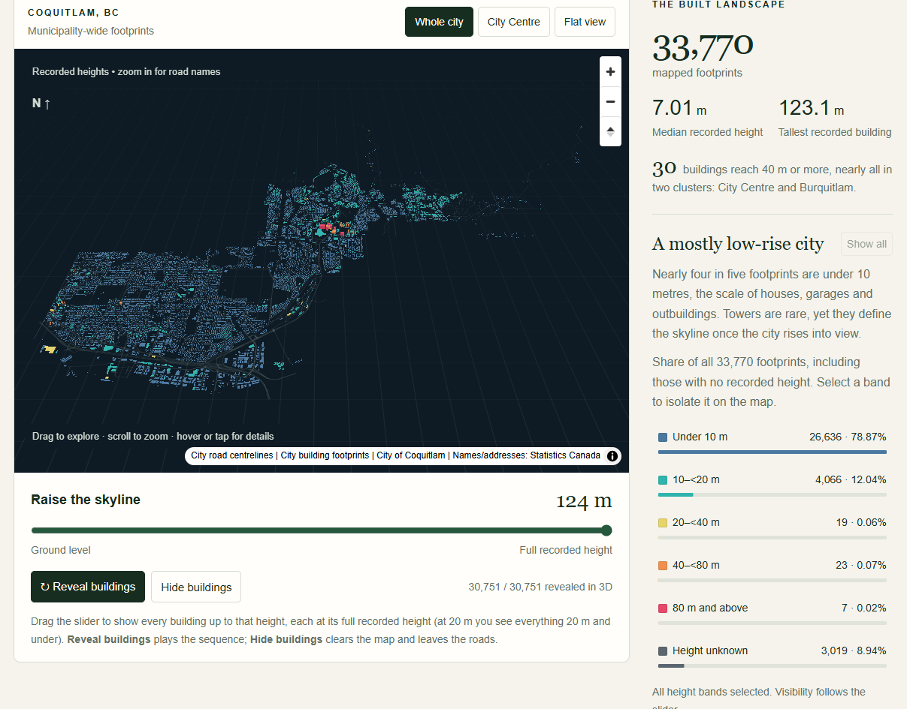

# Coquitlam, rising

**An interactive 3D map of 33,770 buildings in Coquitlam, BC, a fast-growing Metro Vancouver suburb.**
Raise the skyline from ground level and watch the city appear in order of height, until a handful of towers around the SkyTrain stations break away from everything else.

Design & data storytelling by **Iris Sun** for [#30DayMapChallenge](https://30daymapchallenge.org/) Day 5: *Sight*.



**Live map:** _add your GitHub Pages link here after publishing_

## About Coquitlam

Coquitlam is a city of about 150,000 people in Metro Vancouver, roughly 20 km east of downtown Vancouver. Long a suburb of detached homes and green space, it is one of the region's fast-growing cities, and since the Evergreen SkyTrain line opened in 2016, high-rises have been climbing around City Centre and Burquitlam. The data has no construction dates, so the map shows the city's shape as recorded, not its growth over time.

## What you can do

- **Raise the skyline:** drag the slider, or press *Reveal buildings*, to show every building up to a chosen height.
- **Jump between views:** *Whole city*, *City Centre* (the tower cluster) and a flat/3D toggle.
- **Filter by height band:** click a band in the sidebar chart to isolate it. Percentages use all 33,770 footprints as the denominator.
- **Inspect a building:** hover or tap for name, height, category and address where the source has them.
- **Read the streets:** road names appear as you zoom in, major roads first.

## Run locally

No build step, API key or online map service is needed. Everything is bundled. Serve the folder over HTTP (opening `index.html` directly will not load the data):

```bash
python -m http.server 8000 --bind 127.0.0.1
```

Then open <http://127.0.0.1:8000/>. On Windows use `py -m http.server 8000`.

## Publish with GitHub Pages

1. Push this repository to GitHub.
2. Go to **Settings → Pages**, choose **Deploy from a branch**, select `main` and `/ (root)`, and save.
3. After a minute the site is live at `https://<your-username>.github.io/<repo-name>/`. Paste that link into the "Live map" line above.

All paths are relative, so no configuration is needed. `.nojekyll` is included so Pages serves the font folder as is.

## Project structure

```
index.html         page structure and copy
style.css          styles (responsive, down to 390 px wide)
script.js          map, reveal animation, height-band chart, tooltips
data/              buildings.geojson, roads.geojson, summary.json, label-match-audit.json
assets/            MapLibre GL JS, D3.js, local Noto Sans glyphs (road labels) and their licences
prepare_data.py    rebuilds data/ from the three source files
docs/preview.png   screenshot used in this README
```

## Data

| Layer | Source |
| --- | --- |
| Building footprints and heights | [City of Coquitlam Open Data](https://data.coquitlam.ca/) |
| Road centrelines | [City of Coquitlam Open Data](https://data.coquitlam.ca/) |
| Facility names and addresses | [Statistics Canada Open Database of Buildings](https://www150.statcan.gc.ca/n1/pub/34-26-0001/2018001/metadata-eng.htm), matched by footprint overlap |

**Check the licence and currency of each source before reusing this data.** The files in `data/` are derived from the sources above and are not an official City of Coquitlam or Statistics Canada product.

### What the numbers mean

- 33,770 footprints; 30,751 have a positive height, 2,714 have none and 305 are zero. Missing and zero heights are never estimated. They appear only as flat grey shapes under the *Height unknown* filter.
- Heights are the city's `HEIGHT` field in metres, shown without vertical exaggeration on flat ground. Terrain and roof shapes are not modelled.
- Median recorded height is 7.01 m; the tallest is 123.1 m. Bands: under 10 m 26,636; 10–<20 m 4,066; 20–<40 m 19; 40–<80 m 23; 80 m and above 7; unknown 3,019.
- Footprints are source features, not necessarily unique buildings; canopies, tanks and stairs are included. One visibly anomalous category label is suppressed.
- All 24 Statistics Canada names were matched uniquely (at least 95% overlap), and 8 of 9 addresses were kept (one malformed address was omitted, and phone numbers were stripped from two names). A name can describe a facility inside a larger building: the City Centre library name sits on a 105 m tower footprint. See `data/label-match-audit.json`.
- The building file has no construction year or observation date. Road dates describe roads only.

### Rebuild the data

The three source GeoJSON files are not included in this repository. Download them from the sources above, then:

```bash
pip install -r requirements.txt
python prepare_data.py CITY_BUILDINGS.geojson CITY_ROADS.geojson STATCAN_BUILDINGS.geojson
```

Coordinates are rounded to six decimals (about 11 cm). No shapes are otherwise simplified.

## Built with

[MapLibre GL JS](https://maplibre.org/) 5.6.1 and [D3.js](https://d3js.org/) 7.9.0, both bundled with their licences in `assets/`. Road-label glyphs are Noto Sans (SIL Open Font License) from the MapLibre demo tiles.

## Licence

Original code and text: [MIT](LICENSE) © 2026 Iris Sun. Data and bundled third-party files keep their own terms (see above and `assets/`).
